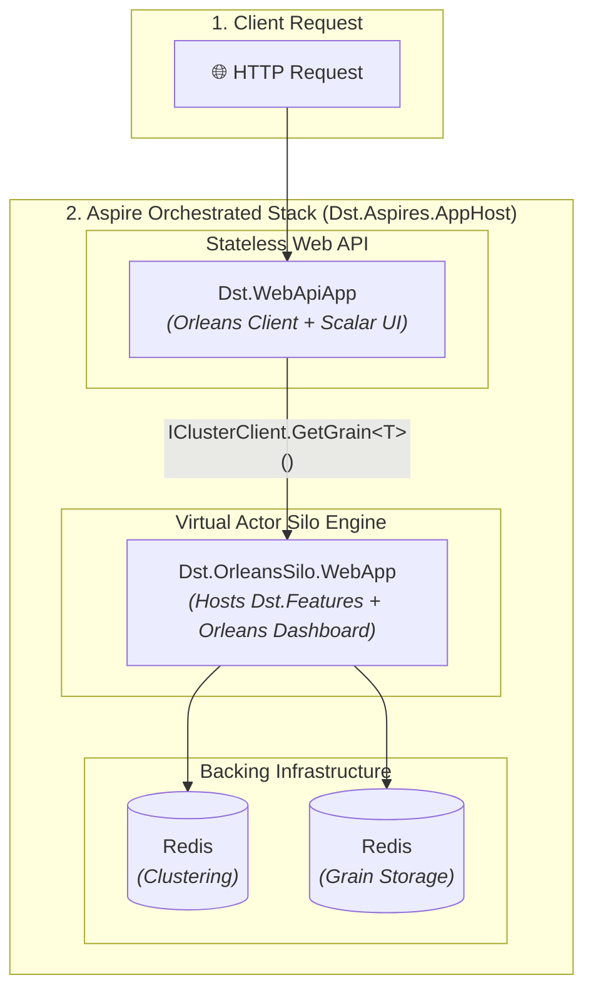

# 🏛️ Architecture & Technical Deep Dive

This document provides a deep dive into the architecture, design principles, conventions, and patterns used in this template.

---

## 💡 Why Orleans + Aspire?

Building distributed systems traditionally requires managing databases, cache synchronizations, concurrency locks, message brokers, and `docker-compose` configurations. This template solves those pain points out-of-the-box:

| Challenge | Traditional Microservices | With Orleans + Aspire (This Template) |
|---|---|---|
| **State & Concurrency** | Manual DB transactions, distributed locks, cache invalidation | **Virtual Actors (Orleans):** Single-threaded execution per grain, in-memory state, auto-activation/deactivation. |
| **Local Development** | Wrestling `docker-compose.yml`, port collisions, service start delays | **.NET Aspire Orchestration:** Redis, Silos, APIs, and OpenTelemetry boot with a single `dotnet run`. |
| **Project Clutter** | Dozens of boilerplate files, complex DI setup for every service | **The 3-Folder Rule:** Focus only on `Core`, `Features`, and `WebApiApp`. Infrastructure stays untouched. |
| **Testing** | Heavy test containers, flaky network mocking | **Native Integration Tests:** Full-solution integration testing via Aspire `DistributedApplicationTestingBuilder` and in-memory Orleans `TestCluster`. |
| **Maintenance** | Package version drift, inconsistent build flags | **Modern .NET Standards:** Central Package Management (CPM), pinned .NET 10 SDK, and automated MinVer semantic releases. |

---

## ⚙️ System Architecture Flow



---

## 🏛️ CQRS & Read-Side Architecture

Grains are a natural fit for operations on one identity: Orleans routes a call to the grain responsible for that identity, and the grain can work with its state in memory. Broad queries are a different problem. Calling many entity grains to build a list or aggregate can introduce substantial message, activation, latency, and aggregation costs.

There is no rule that every Orleans application must use CQRS or a separate database. Depending on the query, a point read from an entity grain, a bounded fan-out, an Orleans projection grain, or a database read model may be appropriate. A projection gives reads a shape designed for their access patterns, in exchange for maintaining derived data and deciding how much staleness is acceptable.

The weather feature demonstrates a projection grain in this repository. See **[Read Projections with Orleans](read-projections-with-orleans.md)** for an actor primer, a fan-out example, projection alternatives, the sample data flow, and consistency and recovery trade-offs.

---

## ⚙️ Key Conventions & Repository Operations

### 1. Central Package Management (CPM)
All NuGet package versions live exclusively in `Directory.Packages.props`. Project files (`.csproj`) reference packages **without** a `Version` attribute:

```xml
<!-- Directory.Packages.props -->
<PackageVersion Include="Serilog" Version="4.0.0" />

<!-- Any .csproj file -->
<PackageReference Include="Serilog" />
```

To add a new package:
1. Add `<PackageVersion Include="Package.Name" Version="x.y.z" />` in `Directory.Packages.props`.
2. Add `<PackageReference Include="Package.Name" />` in your target `.csproj`.

### 2. Pinned .NET SDK
The .NET SDK version is pinned in `global.json`. Any update here applies instantly to all developers and CI/CD pipelines:
```json
{ "sdk": { "version": "10.0.401", "rollForward": "latestPatch" } }
```

### 3. ServiceDefaults Integration
Every service references `Dst.Aspires.ServiceDefaults` and invokes standard extension methods in `Program.cs`:
- `builder.AddServiceDefaults()` — Configures OpenTelemetry (traces, metrics), service discovery, and standard HTTP resilience policies.
- `app.MapDefaultEndpoints()` — Exposes `/health` and `/alive` endpoints.

### 4. Automatic Versioning (MinVer + Conventional Commits)
Versioning is handled automatically based on git history and commit messages:

| Commit Pattern | Version Bump | Example |
|---|---|---|
| `BREAKING CHANGE:`, `feat!:` | **Major** | `1.2.3` $\rightarrow$ `2.0.0` |
| `feat:` | **Minor** | `1.2.3` $\rightarrow$ `1.3.0` |
| `fix:`, `chore:`, `docs:` | **Patch** | `1.2.3` $\rightarrow$ `1.2.4` |

### 5. Cloud-Native Networking & TLS (Why No `UseHttpsRedirection`)
In `Dst.WebApiApp` and `Dst.OrleansSilo.WebApp`, `app.UseHttpsRedirection()` is intentionally **omitted**:
- **Edge TLS Termination:** In cloud-native deployments (Kubernetes Ingress, Azure Container Apps, AWS ALB, Nginx, Cloudflare), SSL/TLS termination and public HTTP $\rightarrow$ HTTPS redirection happen at the **Reverse Proxy / Ingress Controller** level. The ingress forwards decrypted traffic over internal HTTP to containers.
- **Prevents Infinite Redirect Loops:** Enforcing HTTPS redirection inside containers behind reverse proxies can cause infinite 307/308 redirect loops.
- **Reliable Internal Health Probes:** For local Aspire health checks, probes communicate over internal HTTP. `MapDefaultEndpoints()` currently maps `/health` and `/alive` only in Development; see the [production readiness checklist](production-readiness.md) before exposing probes in other environments.

---

## 🧪 Testing Strategy

The host-application test uses Aspire's test hosting library to start the AppHost, wait for the API and Silo resources to become healthy, and check that the Scalar API reference and Orleans Dashboard return HTTP 200. It is a smoke test of the hosted web surfaces; it does not exercise the weather endpoints or grain behavior.

```csharp
// tests/Dst.HostApplication.Tests/WebTests.cs
[Fact]
public async Task GetWebResourcesRootReturnsOkStatusCode()
{
    var cancellationToken = TestContext.Current.CancellationToken;
    var appHost = await DistributedApplicationTestingBuilder.CreateAsync<Projects.Dst_Aspires_AppHost>(cancellationToken);

    appHost.Services.ConfigureHttpClientDefaults(clientBuilder =>
    {
        clientBuilder.ConfigurePrimaryHttpMessageHandler(() => new HttpClientHandler
        {
            ServerCertificateCustomValidationCallback = HttpClientHandler.DangerousAcceptAnyServerCertificateValidator
        });
        clientBuilder.AddStandardResilienceHandler();
    });

    await using var app = await appHost.BuildAsync(cancellationToken);
    await app.StartAsync(cancellationToken);

    await app.ResourceNotifications.WaitForResourceHealthyAsync("Dst-web-api", cancellationToken);
    await app.ResourceNotifications.WaitForResourceHealthyAsync("Dst-web-orleans-silo", cancellationToken);

    using var webApiHttpClient = app.CreateHttpClient("Dst-web-api");
    var scalarResponse = await webApiHttpClient.GetAsync("/scalar/v1", cancellationToken);
    Assert.Equal(HttpStatusCode.OK, scalarResponse.StatusCode);

    using var siloHttpClient = app.CreateHttpClient("Dst-web-orleans-silo");
    var dashboardResponse = await siloHttpClient.GetAsync("/orleans-dashboard", cancellationToken);
    Assert.Equal(HttpStatusCode.OK, dashboardResponse.StatusCode);
}
```

Grain and feature behavior belongs in `Dst.Features.Tests`, which uses Orleans `TestCluster` and in-memory grain storage.

Run all tests from the CLI:
```bash
dotnet test
```

---

## 🔗 References & Official Documentation

- **Microsoft Orleans Architecture & Concepts:**
  - [Orleans Grains Documentation](https://learn.microsoft.com/en-us/dotnet/orleans/grains/) — Virtual actor lifecycle, grain identity, and execution model.
  - [Orleans Silo & Host Configuration](https://learn.microsoft.com/en-us/dotnet/orleans/host/configuration-guide/) — Configuring Silo hosts, dependency injection, and endpoints.
  - [Orleans Grain Persistence](https://learn.microsoft.com/en-us/dotnet/orleans/grains/grain-persistence/) — State management abstractions and storage providers.
- **.NET Aspire Architecture & Testing:**
  - [.NET Aspire AppHost Overview](https://learn.microsoft.com/en-us/dotnet/aspire/fundamentals/app-host-overview) — Distributed topology definition and resource management.
  - [.NET Aspire Service Defaults](https://learn.microsoft.com/en-us/dotnet/aspire/fundamentals/service-defaults) — Standardized OpenTelemetry, health endpoints, and HTTP resilience.
  - [.NET Aspire Testing Overview](https://learn.microsoft.com/en-us/dotnet/aspire/testing/overview) — In-memory distributed testing using `DistributedApplicationTestingBuilder`.
