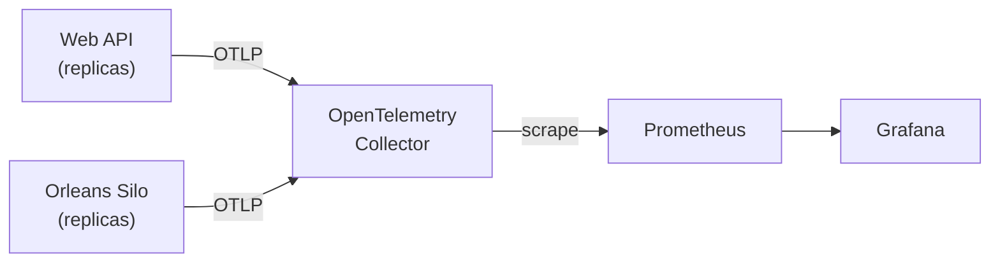

# 🔭 Observability: See Your Cluster Running

When something is slow or broken in a distributed system, you need to answer a few questions fast. Is it the API or the silos? Is it one machine or all of them? Did it start with the last deployment?

This template ships a local Grafana dashboard that answers those questions. The same dashboard idea carries over to production.

---

## What you get

Start the AppHost and open the `grafana` endpoint in the Aspire Dashboard. The **Cell overview** dashboard is already there. No login or setup is needed locally.

| Section | What it tells you |
|---|---|
| **General** | Instance counts, requests per second, response time, failures, and active grains. One glance: is the cell healthy? |
| **Traffic, failures and latency** | Requests, 5xx failures and average response time on one chart. |
| **Build version** | Which build each instance runs. Useful during a rollout, when two versions run side by side. |
| **Silos** | Active vs. deactivated grains over time, the top 10 grain types, how grains are spread across silos, and Orleans' own system grains. |
| **Service resources** | One table per service (Web APIs, Silos). One row per instance: CPU, memory, GC heap, threads and queued work. |

Two dropdowns at the top narrow everything down: **Cell** and **Build number**.

---

## Two ideas behind the dashboard

**Cell.** A cell is one complete copy of the system: its own API, silos and storage. Small systems have one. Larger ones run several, for example one per region or customer group. Every metric is tagged with its cell, so one dashboard serves all of them.

**Build.** Every metric also carries the build number. When latency jumps after a deployment, you can compare builds directly.

In Azure both come from the deployment: the build number is the git tag version without the `v` prefix (tag `v1.2.3` -> image tag `1.2.3` -> `BUILD_NUMBER=1.2.3`). The same value is the assembly version (MinVer) and is reported as `service.version`.

Besides the metric labels, every **log record and trace span** (including logs written inside grains and Orleans grain-call spans) carries `app.cell.id` and `app.build.number`. In Application Insights they show up as custom dimensions on traces and requests/dependencies; metrics keep the build only as a resource attribute, which Prometheus uses as a label locally.

Locally, set both before starting the AppHost (each defaults to `local`):

```bash
APP_CELL_ID=eu-1
BUILD_NUMBER=1.2.3
```

---

## How the data flows



Services only speak OpenTelemetry. They don't know Prometheus or Grafana exist. That is why the storage and the dashboard can change without touching service code.

Only **metrics** go through the collector. Aspire's own logs and traces still go straight to the Aspire Dashboard.

---

## Reading the Silos section

A few things are worth knowing before you trust the numbers.

- **Active** means a grain is in memory. Orleans loads a grain on its first call and unloads it after it has been idle for a while (15 minutes by default). The count rises and falls with traffic.
- **Deactivated** is derived: grains created in the interval minus the change in live grains. It's a good approximation, not an exact count.
- **Per-grain latency isn't built in.** Orleans exports one latency number for the whole cell. If you need it per grain type, add a grain call filter that records it.
- **System grains** are Orleans' own (`sys.*`, `dashboard`, `management`). They are shown apart from yours so they don't hide your numbers. Their counts are normally flat.

Disk and host-level RAM aren't shown. The services export only .NET runtime metrics. Host metrics need a collector running on each machine.

---

## Editing the dashboard

The dashboard is a plain JSON file:

```
src/Aspires/Dst.Aspires.AppHost/observability/grafana/dashboards/cell-overview.json
```

Edit it and refresh the browser. A small helper container makes Grafana reload the file every few seconds, so there is no need to restart Aspire.

Other files in `observability/`: the collector config, the Prometheus scrape config and the Grafana data source.

---

## Taking it to production

The dashboard queries use PromQL, which is the part that changes in production. Keep these three things:

1. **Same telemetry.** Keep the cell and build tags. They are what make the dashboard useful.
2. **Point OTLP somewhere else.** Set `OTEL_EXPORTER_OTLP_ENDPOINT` to your monitoring platform, for example Azure Application Insights.
3. **Rewrite the queries for that store.** For Application Insights, Grafana's Azure Monitor data source uses KQL instead of PromQL. The layout and panels stay the same.

The Prometheus and collector containers are for local use. See [Production Readiness](production-readiness.md) for the full checklist.
