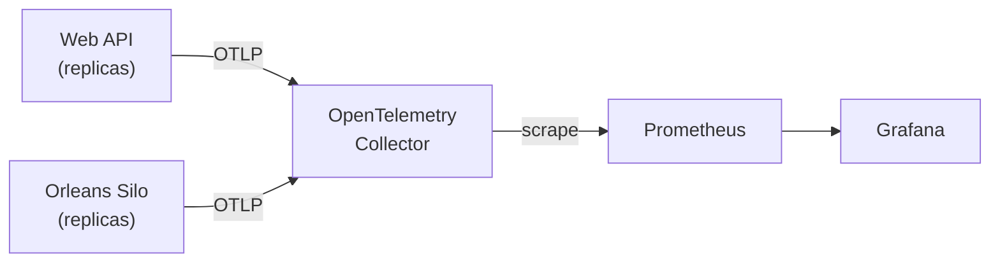

# 🔭 Observability: See Your Cluster Running

When something is slow or broken in a distributed system, you need to answer a few questions fast. Is it the API or the silos? Is it one machine or all of them? Did it start with the last deployment?

This template ships a local Grafana dashboard that answers those questions. The same dashboard idea carries over to production.

---

## What you get

Start the AppHost and open the `grafana` endpoint in the Aspire Dashboard. The **Cell overview** dashboard is already there. No login or setup is needed locally.

| Section | What it tells you |
|---|---|
| **General** | Instance counts, requests per second, response time, failures, and active grains. One glance: is the cell healthy? |
| **Traffic, failures and latency** | Requests, 5xx failures and average response time on one chart. |
| **Build version** | A 100%-stacked timeline of the share of reporting instances on each build. Labels show only build numbers; a rollout shows one version replacing another. |
| **Silos** | Active vs. deactivated grains over time, the top 10 grain types, how grains are spread across silos, and Orleans' own system grains. |
| **Service resources** | One table per service (Web APIs, Silos). One row per instance: CPU, memory, GC heap, threads and queued work. |

Locally, two dropdowns narrow everything down: **Cell** and **Build number**. The Azure dashboard selects the cell; Orleans time series include the build number to distinguish rolling deployments. The Azure Top 10 grain types chart aggregates across builds and replicas, with grain names only.

---

## Two ideas behind the dashboard

**Cell.** A cell is one complete copy of the system: its own API, silos and storage. Small systems have one. Larger ones run several, for example one per region or customer group. Every metric is tagged with its cell, so one dashboard serves all of them.

**Build.** Every metric also carries the build number. When latency jumps after a deployment, you can compare builds directly.

In Azure both come from the deployment: the build number is the git tag version without the `v` prefix (tag `v1.2.3` -> image tag `1.2.3` -> `BUILD_NUMBER=1.2.3`). The same value is the assembly version (MinVer) and is reported as `service.version`.

Besides the metric labels, every **log record and trace span** (including logs written inside grains and Orleans grain-call spans) carries `app.cell.id` and `app.build.number`. In Application Insights they show up as custom dimensions on traces and requests/dependencies.

Both services also emit the observable gauge `dst.build.info`, with value `1` and explicit `app.cell.id` / `app.build.number` dimensions. The value is just a presence indicator, **not** a version number. The Build version panel counts reporting instances per build over the selected time range and stacks their shares to 100%. Legend labels contain only build numbers, not replica names or gauge values. It ignores the build filter so rollouts remain visible; old builds remain in the historical timeline.

Orleans metrics share those build/cell **resource attributes**. Locally the collector copies them onto every Prometheus series, including Orleans metrics. Azure Monitor does not reliably preserve custom metric resource attributes as dimensions, so the Azure dashboard joins Orleans metrics to `dst.build.info` using service, instance and Azure version identity. Orleans time series and the per-silo distribution retain the resulting build label rather than mixing versions together; Top 10 grain types intentionally sums across builds and replicas. This is query-time enrichment, not a modification of Orleans' own instruments. Historical data without a build-info sample is explicitly labelled `unknown (before build-info)` (`unknown` in the per-silo pie chart); redeploy both services to populate the new metric.

Locally, set both before starting the AppHost (each defaults to `local`):

```bash
APP_CELL_ID=eu-1
BUILD_NUMBER=1.2.3
```

---

## How the data flows



Services only speak OpenTelemetry. They don't know Prometheus or Grafana exist. That is why the storage and the dashboard can change without touching service code.

Only **metrics** go through the collector. Aspire's own logs and traces still go straight to the Aspire Dashboard.

---

## Reading the Silos section

A few things are worth knowing before you trust the numbers.

- **Active** means a grain is in memory. Orleans loads a grain on its first call and unloads it after it has been idle for a while (15 minutes by default). The count rises and falls with traffic.
- **Deactivated** is derived: grains created in the interval minus the change in live grains. It's a good approximation, not an exact count.
- **Per-grain latency isn't built in.** Orleans exports one latency number for the whole cell. If you need it per grain type, add a grain call filter that records it.
- **System grains** are Orleans' own (`sys.*`, `dashboard`, `management`). They are shown apart from yours so they don't hide your numbers. Their counts are normally flat.
- **Active grains per silo** is a pie chart with one slice per silo, sized by its currently active application-grain count, not historical peaks. Idle silos appear in the legend with `0` but have no slice; when all counts are zero, the pie is empty. Azure uses the latest samples within 5 minutes and lists silos reporting telemetry in that window. After traffic stops and idle grains deactivate, zero is expected.

Disk and host-level RAM aren't shown. The services export only .NET runtime metrics. Host metrics need a collector running on each machine.

### Azure service resources

The resource tables and instance counts recognize the cell-scoped Container App role names (`dst-{cellId}-web-api-ca` and `dst-{cellId}-web-orleans-silo-ca`), as well as the original service names. They show replicas reporting in the last five minutes, independently of build-info availability. Missing metrics stay blank rather than appearing as healthy zeros.

CPU is the five-minute average divided by `dotnet.process.cpu.count`, the processor count reported by .NET. It is **not** a percentage of the Container App's configured vCPU allocation.

Azure Monitor exports the runtime's thread-pool observable up/down counters as interval changes, so their last sample is not the current thread or queue count. ServiceDefaults also emits `dst.process.thread_pool.thread.count` and `dst.process.thread_pool.queue.length` as observable **gauges**, read directly from `ThreadPool`. The Azure tables use these gauges; the local Prometheus tables retain the cumulative runtime metrics.

After updating the dashboard, CPU, memory and GC heap work with existing deployments. Redeploy **both services** to populate the new thread-pool gauges, then allow for metric export and ingestion. Re-import the Azure dashboard as well: `deploy_only` does not run the dashboard import.

## Synthetic HTTP traffic

`RandomUpdateWeatherBackgroundService` runs in the Web API, not in the silo. It uses `IHttpClientFactory` to POST JSON (`date`, `location`) to its own `/api/commands/weather/update` endpoint. Requests pass through the HTTP middleware, rate limiter and Orleans-backed endpoint, producing HTTP server/client telemetry as well as grain traffic.

Traffic is **disabled by default**. Microsoft Feature Management reads the `RandomWeatherTraffic` feature from the Web API's [appsettings.json](../src/Dst.WebApiApp/appsettings.json). Its `TrafficGeneration` filter uses `Parameters:Enabled` as the initial state:

```json
"FeatureManagement": {
  "RandomWeatherTraffic": {
    "EnabledFor": [
      { "Name": "TrafficGeneration", "Parameters": { "Enabled": false } }
    ]
  }
}
```

Use the **Feature Flags** group in Scalar:

- `GET /api/features/random-weather-traffic` returns `{ "enabled": false, "requestsPerSecond": 20, "maxRequestsPerSecond": 100 }`.
- `PUT /api/features/random-weather-traffic` with `{ "enabled": true, "requestsPerSecond": 50 }` enables traffic at 50 requests/second. `requestsPerSecond` is optional (the current rate is kept); use `"enabled": false` to stop. A rate outside `1..maxRequestsPerSecond` returns `400` and changes nothing.
- These endpoints follow the configured public API authentication. Set `Auth:Mode=JwtBearer` for protected deployments; `None` deliberately leaves the API, including these controls, anonymous.
- Updates are in-memory, **per replica**, and reset on restart. They take precedence over appsettings until restart. With multiple replicas, requests can reach different instances; configure appsettings consistently for a deployment-wide setting rather than treating this endpoint as a shared flag store. Total load is roughly `requestsPerSecond × replicas`.

The `TrafficGeneration` section sets the defaults:

| Setting | Default | Meaning |
|---|---|---|
| `StartupDelay` | `00:05:00` (`00:00:05` in Development) | Wait after startup before the first check; also applies when enabled through the endpoint. |
| `RequestsPerSecond` | `20` (`50` in Development) | Target rate per replica until changed through the endpoint. |
| `MaxRequestsPerSecond` | `100` (`200` in Development) | Upper bound for the target rate; can be raised up to a hard ceiling of `1000`. |
| `MaxConcurrency` | `100` | Maximum in-flight synthetic requests per replica (read at startup). |

The generator paces requests every 50 ms and sends them concurrently, so the rate does not depend on request latency. If `MaxConcurrency` requests are already in flight, due requests are **skipped**, not queued, so a slow backend is not buried under a growing backlog. Verified self-calls are exempt from the per-IP rate limit (they all come from `127.0.0.1`); their volume is bounded by `MaxRequestsPerSecond` instead. Every 30 seconds the Web API logs the target and actual rate with sent/succeeded counts, at Warning when requests failed or were skipped. Only the first failure in each period is logged in full. Failed requests are not retried or replayed. Example calls are in [Dst.WebApiApp.http](../src/Dst.WebApiApp/Dst.WebApiApp.http).

### Self-call authentication without extra resources

Every Web API process generates its own random 256-bit credential at startup, keeps it only in memory, and sends it in a redacted header. The receiver checks the **original socket peer** is loopback before processing forwarded headers, compares the credential in constant time, and accepts it **only** for `POST /api/commands/weather/update`. This narrowly scoped identity can pass that route's JWT requirement and the Front Door check, but cannot access feature controls or other protected routes. Public callers still need the usual JWT; a spoofed forwarding header does not grant self-call access.

Self-calls target `127.0.0.1` on the Web API's HTTP port, even when Kestrel listens on a wildcard such as `http://[::]:8080` (the container default). `[::1]` is used only if the app is explicitly bound to it, because Azure Container Apps replicas have no IPv6 loopback.

The factory client uses the actual bound HTTP port, never a public URL, proxy or other replica; redirects and automatic retries are disabled to avoid leaking the credential or replaying updates. An HTTP listener is required (as provided locally and in ACA). Nothing is stored in appsettings or provisioned in Azure for this credential. This simulates the API/Orleans HTTP workload, **not** traffic through Front Door/WAF; use an external authenticated load test for edge testing.

---

## Editing the dashboard

The dashboard is a plain JSON file:

```
src/Aspires/Dst.Aspires.AppHost/observability/grafana/dashboards/cell-overview.json
```

Edit it and refresh the browser. A small helper container makes Grafana reload the file every few seconds, so there is no need to restart Aspire.

Other files in `observability/`: the collector config, the Prometheus scrape config and the Grafana data source.

---

## Taking it to production

The dashboard queries use PromQL, which is the part that changes in production. Keep these three things:

1. **Same telemetry.** Keep the cell and build tags. They are what make the dashboard useful.
2. **Point OTLP somewhere else.** Set `OTEL_EXPORTER_OTLP_ENDPOINT` to your monitoring platform, for example Azure Application Insights.
3. **Rewrite the queries for that store.** For Application Insights, Grafana's Azure Monitor data source uses KQL instead of PromQL. The layout and panels stay the same.

The template already does this: Azure Managed Grafana is enabled by default and the deployment imports `src/Aspires/Dst.Aspires.AppHost/deploy/grafana/cell-overview.azure.json`, a KQL version of the dashboard. Managed Grafana incurs Azure charges; set `GRAFANA_ENABLED=false` to opt out before provisioning. See "Dashboards in Azure" in the [deployment README](../src/Aspires/Dst.Aspires.AppHost/deploy/README.md).

The Prometheus and collector containers are for local use. See [Production Readiness](production-readiness.md) for the full checklist.
