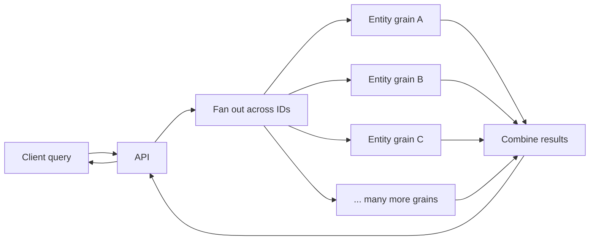
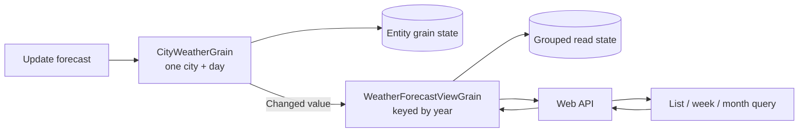

# 📊 Read Projections with Orleans

Orleans grains are a natural fit for work on one entity. Lists and aggregations are less straightforward. This guide explains why, and shows a few ways to handle those reads—including the projection grain in this template.

## 🧠 A short actor primer

In Orleans, application logic lives in **grains**: virtual actors identified by a key, such as an account ID or a city and date. Call a grain by its key; Orleans routes the call to the silo hosting it.

While active, a grain keeps its state in memory. Orleans manages where it runs and when it activates or deactivates. Calls to a grain are processed one at a time by default, so its state can often be updated without application-level locks. Grain storage can persist state, but changes must still be written.

That works well for a **point operation** like “get account 42.” A list or aggregate across many accounts is a different problem.

## 🔎 The read-query challenge

Imagine one weather grain per city and date. Getting one forecast means calling one grain. Getting “all cities this month” means reading many.

### The naive solution: fan out to the entity grains

An API might call every relevant grain and combine the results:

```csharp
var tasks = forecastIds.Select(id =>
    grainFactory.GetGrain<ICityWeatherGrain>(id.DayOfYear, id.Location).GetAsync());

var results = await Task.WhenAll(tasks);
```

Parallel calls may finish sooner, but each call still costs something: messages, network hops, possible grain activations, and work to combine results. The API also needs a way to find all the IDs.



Fan-out can be fine for a small, known set. It is a poor default for large lists, search, pagination, or reporting.

## 🧰 Give reads a shape that fits the query

For broad reads, keep data in a shape that matches the query. Entity grains still own their state and business rules; a read side groups or indexes data for queries.

There are several options:

- **Projection grain:** Keep a purpose-built view in Orleans. Choose its key and partitions to match expected queries and traffic.
- **Database read model:** Use a relational or document database for joins, flexible filtering, full-text search, or reporting.
- **Event-driven projection:** Update read stores from events or messages if the system already has that infrastructure.
- **Grain fan-out:** Call entity grains directly when the set is small and bounded.

A projection is derived data, not the authority for business decisions. Keep invariants in the entity grains. Choose the read side based on the query, expected load, freshness needs, and operational cost.

## 🌦️ The template's projection grain

The weather feature shows a projection grain in action:

1. A `CityWeatherGrain` owns the forecast for one city and day.
2. When its changed state is flushed, it sends the location, day, and temperature to a `WeatherForecastViewGrain`.
3. The view grain is keyed by year and stores temperatures grouped by location and day.
4. Query endpoints ask the view grain for a year, month, week, or list of locations—without calling every city/day grain.



See [CityWeatherGrain.cs](../src/Dst.Features/WeatherForecasts/CityWeatherGrain.cs), [WeatherForecastViewGrain.cs](../src/Dst.Features/WeatherForecasts/WeatherForecastViewGrain.cs), and [Program.cs](../src/Dst.WebApiApp/Program.cs) for the implementation.

The yearly view grain suits this sample. A busier system might need more partitions, a database, or both.

## ⚖️ The trade-offs: consistency, cost, and complexity

The entity and view are separate state, so updating both is not atomic here. `CityWeatherGrain` changes its state, then a timer persists it and sends the update to the view grain. The view also saves on a timer. A command can finish before the view reflects the change.

This is **eventual consistency**: the view catches up, but may briefly be behind. If the process fails between the entity write and the projection update, the view may stay stale. This sample does not include a durable outbox or a way to rebuild the projection.

| Choice | Benefit | Cost |
|---|---|---|
| Query every entity grain | Current entity data | Fan-out, latency, and activation load |
| Maintain a projection | Reads fit the query | Staleness, duplicate data, and recovery work |
| Use a database read model | Flexible queries and indexing | Another store to operate and keep updated |
| Use one view grain | Simple design | May become a hot spot or grow too large |

No design gives you everything. Decide how stale reads can be, how updates are retried, and how the view can be rebuilt. If a request needs an immediate answer, return the command result or read the authoritative entity grain instead of assuming the projection is current.

## 🧭 A practical decision path

When adding a read endpoint, ask:

1. One known entity? Call its grain.
2. A small, fixed set? Fan-out may be fine; measure it.
3. A broad list, search, or aggregate? Consider a projection.
4. Need joins or flexible search? A database may fit better.
5. How fresh must the result be? Decide that before choosing the design.

Not every read needs a projection. Choose the simplest design that fits the query and its freshness requirements.

## 🔗 References & Official Documentation

- [Microsoft Orleans grains](https://learn.microsoft.com/en-us/dotnet/orleans/grains/) — Grain identity, lifecycle, and execution model.
- [Orleans grain persistence](https://learn.microsoft.com/en-us/dotnet/orleans/grains/grain-persistence/) — Persisting grain state through storage providers.
- [Orleans transactions](https://learn.microsoft.com/en-us/dotnet/orleans/grains/transactions) — Transaction support and its boundaries.
- [Command Query Responsibility Segregation (CQRS)](https://learn.microsoft.com/en-us/azure/architecture/patterns/cqrs) — A pattern for separating write and read models.
